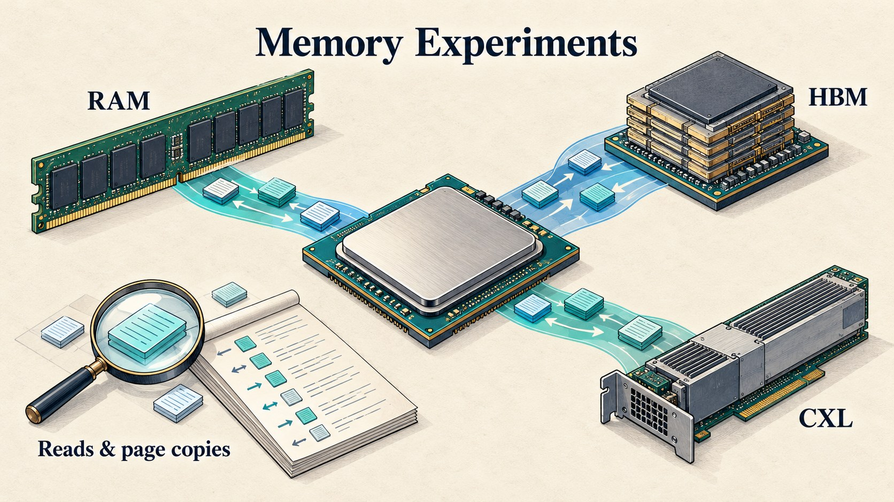

# RAM, HBM & CXL Memory Benchmarks

*Conceptual illustration of memory tiers and page operations; not the measured server layout or a performance comparison.*

C++ microbenchmarks, recorded measurements and a literature review of CXL memory for database systems. This student project compares page reads, page copies and simple data placement across RAM, HBM and CXL-attached memory.

## How the work developed

I started by reviewing **CXL Memory Performance for In-Memory Data Processing** by Weisgut et al. (PVLDB 2025). I presented the paper's experiments and discussed how access patterns and data placement affect database performance.

The course project took this topic into practical experiments. I used small C++ programs to measure memory reads, writes and page copies across RAM, HBM and CXL memory, then explored a simple hot/warm/cold placement model.

| Stage | Work | Material in this repository |
| --- | --- | --- |
| Seminar | Review and presentation of published research | [Short reading summary](seminar/README.md) |
| Course project | Memory microbenchmarks and interpretation | [Code, results and experiment guide](benchmarks/README.md) |
| Master's thesis | Further work on memory management and query execution | To be added after completion and a separate publication review |

The seminar explains results from the cited researchers. The benchmark folder contains the course project's own recorded dataset. These are separate experiments on different systems.

## A first look at the results

In the recorded local-copy tests, HBM had the highest observed mean throughput, followed by RAM and CXL. Other operations have different rankings. For example, RAM had the highest observed mean sampled-read result; this does not establish a statistically reliable ordering over HBM. These measurements describe one experimental configuration, not general limits for the memory technologies.

## What is included

- Five C++ benchmark/simulation programs.
- Recorded measurements, summaries and six plots.
- Scripts for new runs on a suitably configured Linux system and for plotting saved results.
- An explanation of the seminar, experimental method and limitations.

This is a set of microbenchmarks and a placement simulation. It is not a complete DBMS buffer manager, a reproduction of the paper's full database evaluation, or completed thesis work.

## Research summaries

- [Short summary of the seminar topic](seminar/README.md).
- [Public material and private submissions](MATERIALS.md).

## Reading and running

Start with the [seminar review](seminar/README.md) for the background, then the [benchmark guide](benchmarks/README.md) for the measurements and execution instructions. The saved data can be studied without CXL hardware.

For a technical review, start with the [code walkthrough](benchmarks/src/README.md), then follow a program through its recorded measurements and result plots.

## Benchmark status

The current tools fix argument validation, use a steady clock and verify full destination contents after both copy passes. The NUMA program checks allowed nodes and queries page residency, failing if placement cannot be verified. These changes have not produced new CXL hardware results.

The recorded dataset predates the corrected source. Its measurement-era code is retained privately with the original coursework; the current programs have not produced replacement hardware measurements. [Known limitations](benchmarks/KNOWN-LIMITATIONS.md) distinguish corrected code from unresolved experimental limits.

## Publication edition

This repository is a reviewed public edition of earlier coursework. The original submissions are retained separately. The READMEs summarize the topics discussed and explain the public code and measurements. Full reports, report sources, presentation text, speaker notes and slide-by-slide outlines are kept private. Personal contact details and internal machine identifiers are omitted. Numeric measurements are preserved; node-identifier columns are omitted from public CSVs.

Only the completed seminar and course-project material is included. No supervisor prototype, private correspondence or thesis implementation is distributed here.

## Permission and acknowledgements

The completed seminar and course-project materials are shared with permission from my supervisor, Prof. Dr. Maximilian E. Schüle.

I thank Prof. Dr. Maximilian E. Schüle for his supervision and feedback, and for encouraging me to publish the work together with its measured results.

I also thank the Data Engineering group at the University of Bamberg for access to the research server used for the measurements.

## Main reference

Marcel Weisgut, Daniel Ritter, Pınar Tözün, Lawrence Benson and Tilmann Rabl. **CXL Memory Performance for In-Memory Data Processing**. PVLDB 18(9), 3119–3133, 2025. [DOI](https://doi.org/10.14778/3746405.3746432) · [Publisher's paper](https://www.vldb.org/pvldb/vol18/p3119-weisgut.pdf).

The third-party paper is linked, not redistributed. Its experiments and illustrations belong to its authors. See [references and attribution](REFERENCES.md).

## Publication status

This is a personal portfolio repository, not an official publication of the University of Bamberg.

Code: MIT. Original text, plots and benchmark tables: CC BY 4.0. See [license scope](LICENSES.md) and [third-party exclusions](RIGHTS.md).

Reviewed CSV dispersion (median, min/max, sample SD) is available in [benchmarks/review/](benchmarks/review/). Historical PNGs and measurement files remain unchanged.

This repository contains the current public edition only. Earlier repository histories and original coursework remain in private archives.
