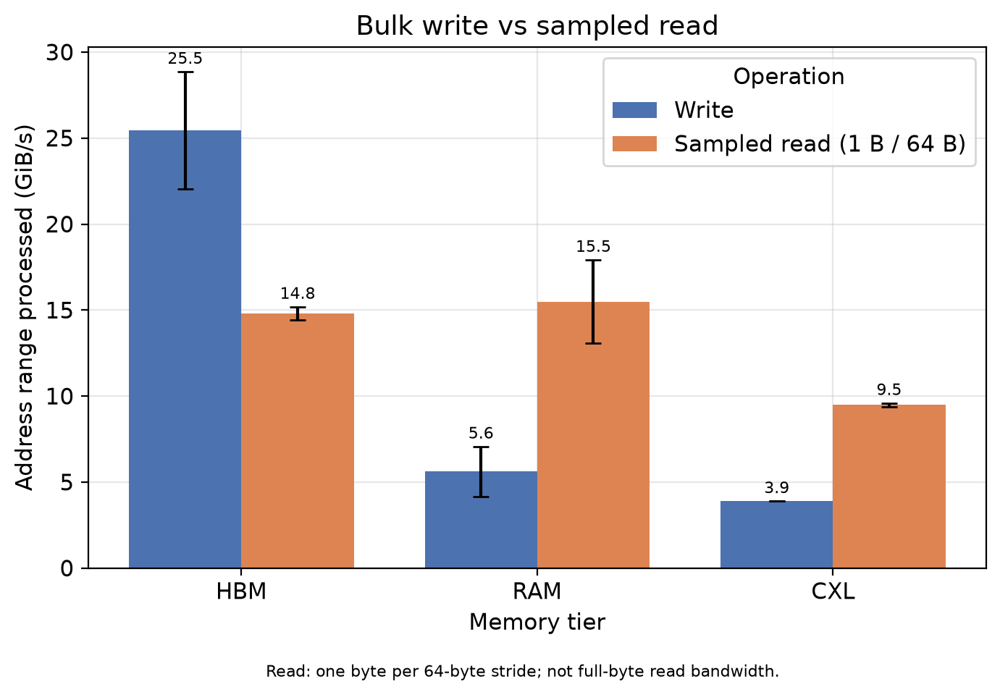
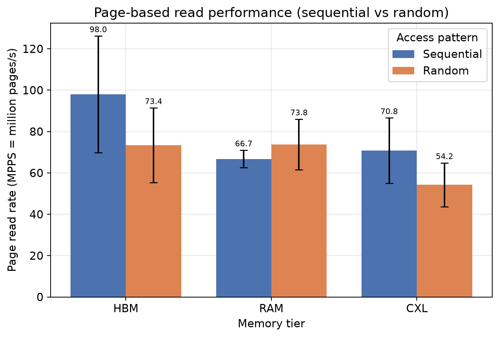
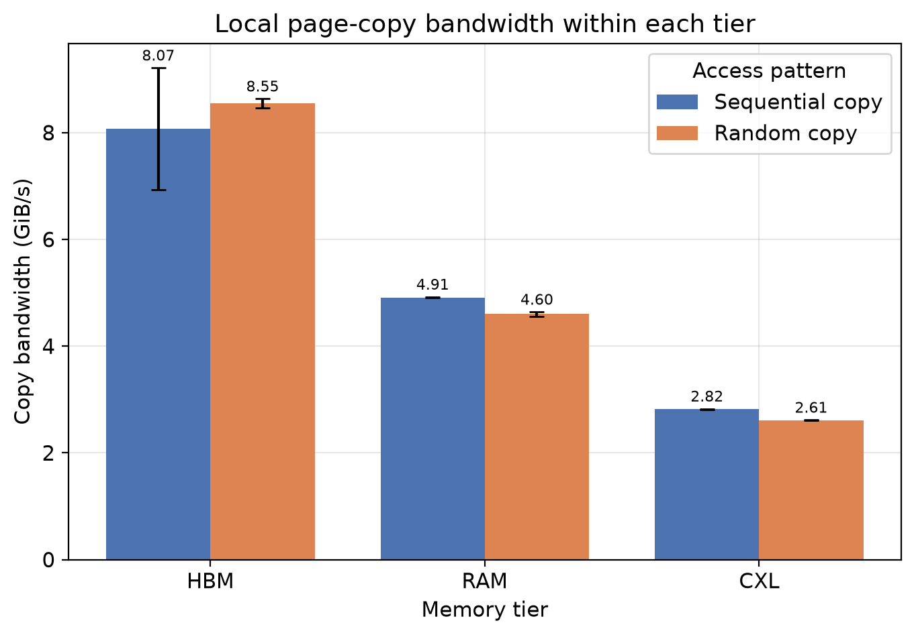
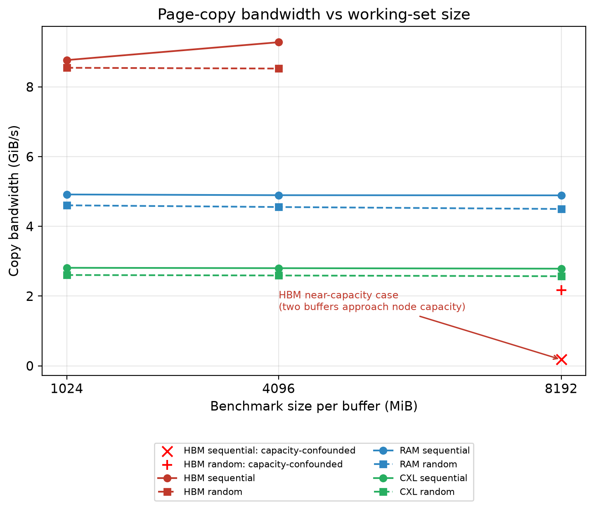
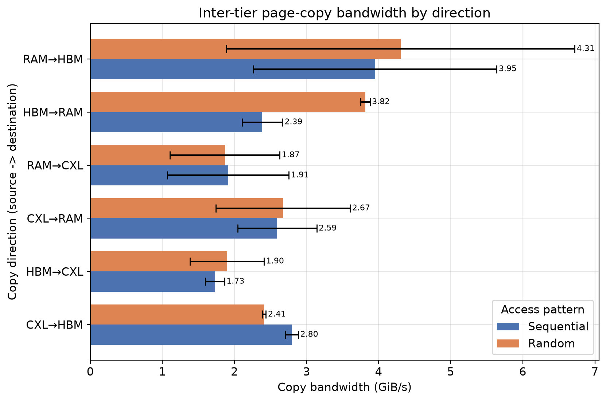
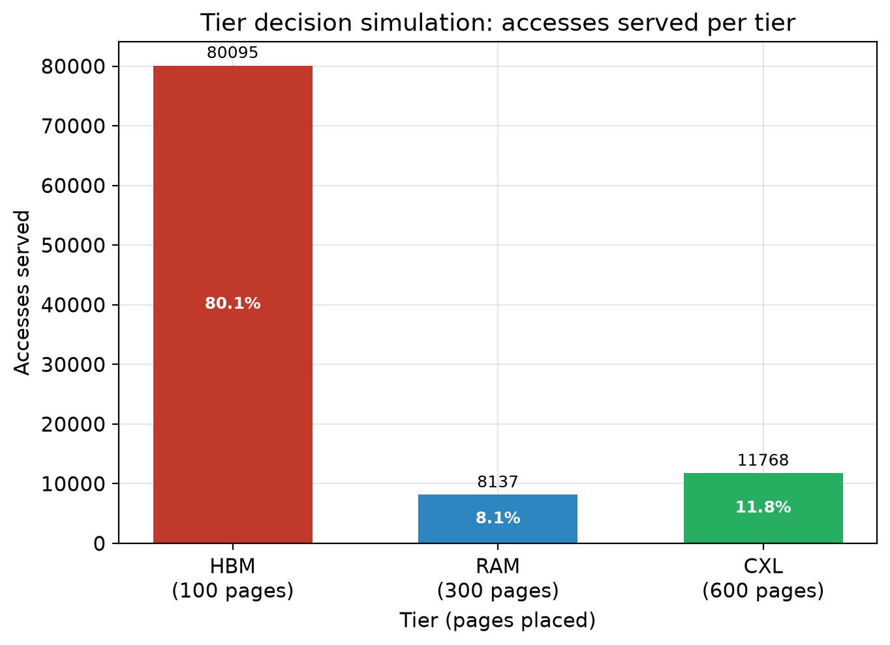

# RAM, HBM and CXL page-operation benchmarks

The course project explores how memory tiers behave for operations that matter to a page-based buffer manager. It includes recorded measurements and a small synthetic placement example.

This README summarizes the project. The full report, its source files and presentation materials are kept private.

## Scope and environment

The recorded runs used an Intel Xeon CPU Max 9462 system with RAM, HBM and CXL memory exposed as separate NUMA nodes. The original build used g++ 13.3.0 with C++17 and `-O3`. Single-tier runners fixed CPU placement; the historical inter-tier runner did not pin CPU execution.

Internal hostnames, device paths and actual node identifiers are omitted from this public edition. Public CSVs preserve all measured values while omitting `cpu_node`, `mem_node`, `src_node` and `dst_node` metadata columns. On another system, discover and configure the actual node mapping before running anything.

## Programs

| Program | Operation |
| --- | --- |
| `memory_benchmark` | Bulk write and read sampling one byte every 64 bytes |
| `page_benchmark` | Sequential/shuffled one-byte reads per 4 KiB page |
| `page_copy_benchmark` | Sequential/shuffled complete 4 KiB page copies within a tier |
| `inter_tier_copy_benchmark` | Copies between source/destination buffers placed through libnuma |
| `tier_decision_simulation` | Synthetic accesses and fixed hot/warm/cold placement capacities |

The read bandwidth reports the covered address range per second, not an explicit load of every byte. Page-read throughput is not single-access latency. The simulation runs without actual CXL hardware and is not a complete buffer manager.

## Recorded results

Bandwidth values below use **GiB/s**. Legacy CSV field names such as `size_mb` and `*_gbs` mean MiB and GiB/s.

| Tier | Bulk write | Sampled read | Sequential local copy | Random local copy |
| --- | ---: | ---: | ---: | ---: |
| RAM | 5.6213 | 15.4948 | 4.9134 | 4.5997 |
| HBM | 25.4581 | 14.8048 | 8.0708 | 8.5465 |
| CXL | 3.8976 | 9.4835 | 2.8179 | 2.6090 |



The local-copy runs show the highest throughput on HBM. The sampled-read test has the highest observed mean for RAM; this does not establish a reliable ordering over HBM. The fastest tier depends on the operation.




## Working-set size and direction

The size sweep covers 1024, 4096 and 8192 MiB per buffer. Each copy run allocates two buffers. The 8192 MiB HBM case therefore approaches 16 GiB total, near the tested node's capacity. Treat that case separately from normal HBM throughput.




The inter-tier results vary by direction and include CPU-placement/NUMA effects. Each direction has only three repetitions. For example, RAM-to-HBM random copy has about 56% sample coefficient of variation. These means should not be used as fixed migration-cost constants.

## Placement example

The simulation generates 100,000 accesses across 1,000 pages with a skew toward a 100-page hot set. The recorded run places 100 pages in HBM, 300 in RAM and 600 in CXL. Those groups serve 80,095, 8,137 and 11,768 accesses respectively.



This is an illustrative offline assignment, not measured query speedup or an implemented replacement/migration policy. Fixed random seeds do not ensure bit-identical distribution/shuffle results across C++ standard libraries. Use the original Linux/g++ environment for the recorded output.

## Build and run

Linux requirements: a C++17 compiler, `numactl` and libnuma development files. Memory-tier experiments require the corresponding hardware. The standalone simulation can run without it.

```bash
bash scripts/build.sh
./build/tier_decision_simulation
```

For new runs, explicitly choose the local system's mapping and a new output directory:

```bash
export CPU_NODE=<cpu-node>
export RAM_NODE=<ram-node>
export HBM_NODE=<hbm-node>
export CXL_NODE=<cxl-node>
export RUN_DIR=./new-results
bash scripts/run_benchmarks.sh
```

Replace the placeholders with valid node numbers. The runner refuses an existing output directory to protect previous data. New runs save stdout/stderr and local environment metadata, which can contain machine identifiers and must be reviewed before sharing. Inter-tier CPU binding is explicit in the revised runner; the saved course results retain the old method. The run requires several GiB of available memory and should be used on a suitable research machine.

To plot the saved dataset, install NumPy, pandas and Matplotlib, then run:

```bash
python3 scripts/plot_results.py --out new-reviewed-plots
```

The plotting script reads checked-in CSVs and writes a new `plots-reviewed/` directory; it refuses an existing output directory and does not execute benchmarks.

## Evidence and limits

All five raw/summary CSV families (90 raw rows) were independently checked: their saved means agree to the recorded rounding precision. The files use five repetitions for basic memory/page/local-copy cases and three per size/direction for the other cases. The separate legacy raw text and capacity-check logs are included with internal identifiers removed. The raw text log has three runs and is a separate record from the five-run memory CSV; it is not a replacement for that CSV.

The experiments are single-threaded microbenchmarks on one system. Cache state, CPU placement, frequency and allocation behavior affect the results. The historical runs did not provide per-run residency proof. There is no SSD comparison, full DBMS workload, general concurrency test or CXL query evaluation here.

The [known limitations](KNOWN-LIMITATIONS.md) document confirmed gaps in copy-integrity checking and input validation, plus placement and timing considerations. Current code addresses implementation checks; experimental limits remain before collecting a new research dataset. Completed-course measurements have not been silently replaced with results from another machine.

## Relationship to the seminar and thesis

The [seminar](../seminar/README.md) provided the background and placement question. This project supplied measurements for page-oriented operations. A completed thesis artifact may be added later; no thesis implementation or supervisor prototype is included now.

## Corrected tools and historical results

The measurement-era source is retained privately with the original coursework. The current source fixes input, copy verification and timing/placement checks. New output is separate from `results/`; never describe the recorded coursework data as results from the corrected code. The page-read working set can remain cache-resident and fixed run order remains a limitation. See [current limitations](KNOWN-LIMITATIONS.md).

To create reviewed charts from the recorded CSVs without replacing historical PNGs:

```bash
python scripts/plot_results.py --out new-reviewed-plots
```

The target directory must not already exist. Install plotting dependencies from `requirements-plots.txt`. Linux uses a C++17 compiler and `libnuma-dev`.

The manual copy CSV and capacity-check text are retained as historical supplementary records. Their exact collection time, CPU pinning and complete command context are unknown; their values are not averaged with the automated series.

Reviewed CSV dispersion (median, min/max, sample SD) is available in [review/](review/). Historical PNGs and measurement files remain unchanged.
